<p align="center">
  <svg width="160" height="160" viewBox="0 0 160 160" role="img" aria-label="Codex Termux">
    <title>Codex Termux</title>
    <defs>
      <linearGradient id="codex-green" x1="0%" y1="0%" x2="100%" y2="100%">
        <stop offset="0%" stop-color="#10a37f"/>
        <stop offset="100%" stop-color="#00d4a0"/>
      </linearGradient>
      <filter id="codex-glow">
        <feGaussianBlur stdDeviation="3" result="blur"/>
        <feMerge><feMergeNode in="blur"/><feMergeNode in="SourceGraphic"/></feMerge>
      </filter>
    </defs>
    <circle cx="80" cy="80" r="68" fill="#071411" stroke="url(#codex-green)" stroke-width="3" opacity=".95">
      <animate attributeName="r" values="64;70;64" dur="5s" repeatCount="indefinite"/>
      <animate attributeName="opacity" values=".72;1;.72" dur="5s" repeatCount="indefinite"/>
    </circle>
    <circle cx="80" cy="80" r="55" fill="none" stroke="#10a37f" stroke-width="1" opacity=".45">
      <animateTransform attributeName="transform" type="rotate" from="0 80 80" to="360 80 80" dur="18s" repeatCount="indefinite"/>
    </circle>
    <path d="M80 27c-10 0-18 5-22 14-10-1-19 3-24 12-5 8-4 18 1 26-5 8-6 18-1 26 5 9 14 13 24 12 4 9 12 16 22 16s18-7 22-16c10 1 19-3 24-12 5-8 4-18-1-26 5-8 6-18 1-26-5-9-14-13-24-12-4-9-12-14-22-14Z" fill="none" stroke="url(#codex-green)" stroke-width="5" stroke-linejoin="round" filter="url(#codex-glow)"/>
    <path d="M55 56c8 4 13 12 13 24s-5 20-13 24m50-48c-8 4-13 12-13 24s5 20 13 24M62 80h36" fill="none" stroke="#b8ffe9" stroke-width="5" stroke-linecap="round"/>
  </svg>
</p>

<h1 align="center">Codex Termux</h1>

<p align="center">
  <strong>OpenAI Codex deneyimini Android ARM64 üzerinde Termux'a taşıyan, terminal-first topluluk fork'u.</strong><br/>
  <sub>Telefonundan kod keşfet • dosyalarını düzenle • komutlarını çalıştır • oturumunu kontrol et</sub>
</p>

<p align="center">
  <a href="https://github.com/ThT0AltayHR/codex-termux/stargazers"></a>
  <a href="https://github.com/ThT0AltayHR/codex-termux/network/members"></a>
  <a href="https://github.com/ThT0AltayHR/codex-termux/issues"></a>
  <a href="https://github.com/ThT0AltayHR/codex-termux/commits/main"></a>
</p>

<p align="center">
  <a href="https://github.com/ThT0AltayHR/codex-termux"></a>
  <a href="https://github.com/ThT0AltayHR/codex-termux/actions"></a>
  <a href="./LICENSE"></a>
  <a href="https://github.com/openai/codex"></a>
</p>

<p align="center">
  <a href="https://www.npmjs.com/package/@mmmbuto/codex-cli-termux"></a>
  <a href="https://github.com/ThT0AltayHR/codex-termux/releases"></a>
  <a href="https://t.me/AltayHR"></a>
  <a href="https://github.com/ThT0AltayHR/codex-termux/discussions"></a>
</p>

<p align="center">
  <a href="https://github.com/ThT0AltayHR/codex-termux"></a>
</p>

<p align="center">
  <a href="https://github.com/ThT0AltayHR/codex-termux"><strong>★ Projeyi yıldızla</strong></a>
  &nbsp;·&nbsp;
  <a href="https://github.com/ThT0AltayHR/codex-termux/issues/new"><strong>Hata bildir</strong></a>
  &nbsp;·&nbsp;
  <a href="https://t.me/AltayHR"><strong>Telegram'dan ulaş</strong></a>
</p>

> [!IMPORTANT]
> Bu sayfadaki ekran görüntüleri Termux üzerinde kullanıcı tarafından sağlanan gerçek oturum kayıtlarıdır. Donanım, Android sürümü, Termux sürümü, hesap kotası ve ağ koşulları değişebileceği için hiçbir mobil cihaz için evrensel çalışma garantisi verilmez.

## İçindekiler

- [Bu proje nedir?](#bu-proje-nedir)
- [Tek komutla kurulum](#tek-komutla-kurulum)
- [İlk giriş ve günlük kullanım](#ilk-giriş-ve-günlük-kullanım)
- [Komut merkezi](#komut-merkezi)
- [TUI slash komutları](#tui-slash-komutları)
- [API sağlayıcısı ve model seçimi](#api-sağlayıcısı-ve-model-seçimi)
- [Bu fork'ta ne değişti?](#bu-forkta-ne-değişti)
- [Değişiklik kanıtı ve dosya haritası](#değişiklik-kanıtı-ve-dosya-haritası)
- [Termux ekran galerisi](#termux-ekran-galerisi)
- [Görsel widget duvarı](#görsel-widget-duvarı)
- [Kota ve hesap kullanımı](#kota-ve-hesap-kullanımı)
- [Sık sorulan sorular](#sık-sorulan-sorular)
- [Yol haritası](#yol-haritası)
- [Lisans, upstream ve yayın hakkı](#lisans-upstream-ve-yayın-hakkı)
- [Resmi kaynaklar](#resmi-kaynaklar)
- [Katkı ve geliştirici kredileri](#katkı-ve-geliştirici-kredileri)
- [Destek ol](#destek-ol)

## Bu proje nedir?

**Codex Termux**, OpenAI Codex CLI'nin Android/Termux kullanımını kolaylaştıran
topluluk odaklı bir fork'tur. Hedef; masaüstü deneyimini kopyaladığını iddia
etmek değil, Termux'un Android/Bionic ortamında gereken paketleme, başlatma,
paylaşılan kütüphane ve kullanıcı deneyimi katmanını mümkün olduğunca sade
hale getirmektir.

### Neyi çözmeye çalışıyoruz?

| Sorun | Codex Termux yaklaşımı |
| --- | --- |
| Android'de doğru native binary'yi bulma | Güncel yerel kaynak derlemesi → paketlenmiş binary → doğrulanmış runtime sırası |
| İlk çalıştırmada karmaşık login | `start.sh` login durumunu kontrol eder ve gerektiğinde `codex login` akışını açar |
| CLI komutlarının login'e takılması | `help`, `doctor`, `config`, `login`, `exec` gibi açık argümanlar doğrudan binary'ye iletilir |
| Model sağlayıcısını TUI'den değiştirememe | `/api` ile yapılandırılmış sağlayıcılar arasında ok tuşlarıyla seçim |
| Model listesinin sabit kalması | `/model` mevcut sağlayıcının model kataloğunu kullanır |
| Android'e uygun paketleme | ARM64 binary, `libc++_shared.so`, `CODEX_SELF_EXE`, `LD_LIBRARY_PATH` ve SHA-512 doğrulaması |

### 10 saniyelik özet

```text
clone → ./start.sh → login → Codex TUI
                         ├─ codex help
                         ├─ /api
                         ├─ /model
                         └─ /status
```

## Tek komutla kurulum

### Yöntem A — Depoyu klonla ve başlat

Kurulumu **home dizininden** başlat. Böylece depo `~/codex-termux`
altına yalnızca bir kez oluşturulur:

```bash
cd ~
git clone https://github.com/ThT0AltayHR/codex-termux.git "$HOME/codex-termux"
cd "$HOME/codex-termux"
chmod +x start.sh
bash ./start.sh
```

### Zaten kuruluysa tekrar clone yapma

Terminal satırında `~/codex-termux` görüyorsan doğrudan şunu kullan:

```bash
cd ~/codex-termux
git pull --ff-only origin main
bash ./start.sh
```

`git clone` komutunu bu klasörün içindeyken tekrar çalıştırma. Aksi hâlde
`~/codex-termux/codex-termux` şeklinde iç içe ikinci bir depo oluşur.

### `~/codex-termux/codex-termux` oluştuysa düzeltme

Bu işlem mevcut iç içe depoyu silmez; önce yedek adını korur:

```bash
cd ~
mv codex-termux codex-termux-backup
mv codex-termux-backup/codex-termux codex-termux
cd ~/codex-termux
git pull --ff-only origin main
chmod +x start.sh
bash ./start.sh
```

Codex doğru açıldıktan sonra eski boş dış klasörü kaldırabilirsin:

```bash
rm -rf ~/codex-termux-backup
```

İlk çalıştırmada `start.sh`, GitHub Actions tarafından hazırlanmış güncel
Android ARM64 runtime paketini indirir, SHA-512 ile doğrular ve çalıştırır.
Termux üzerinde Rust, Cargo, Android NDK veya kaynak derlemesi gerekmez.
Bu paket fork'a özgü `/api`, `/model`, `doctor` ve `config` değişikliklerini
içerir.

`start.sh` akışı:

1. kendi çalıştırma iznini düzeltir,
2. varsa güncel GitHub Actions release runtime'ını kullanır,
3. yoksa depodaki paketlenmiş binary'yi arar,
4. SHA-512 değerini kontrol eder,
5. daha önce login yapılmadıysa `codex login` akışını açar,
6. login tamamlanınca Codex TUI'yi başlatır.

İnternet bağlantısı olmayan bir cihazda, paket daha önce indirilmişse cache'den
çalışır. İlk kez indirme için kısa süreli internet gerekir. Geliştirici olarak
kaynak sürümünü açıkça zorlamak istersen:

```bash
cd ~/codex-termux
CODEX_USE_SOURCE=1 bash ./start.sh
```

Sonraki açılış:

```bash
cd ~/codex-termux
bash ./start.sh
```

### Yöntem B — npm ile Termux paketi

```bash
pkg update && pkg upgrade -y
pkg install nodejs-lts curl tar coreutils -y
npm install -g @mmmbuto/codex-cli-termux@latest
codex login
codex
```

### Ön koşullar

| Bileşen | Normal önceden derlenmiş yol | Kaynak fallback |
| --- | ---: | ---: |
| Android ARM64 cihaz | gerekli | gerekli |
| Termux | gerekli | gerekli |
| `curl` veya `wget` | gerekli | önerilir |
| `tar` | gerekli | gerekli |
| `sha512sum` | runtime indirmede gerekli | önerilir |
| Node.js | gerekli değil | npm yolunda gerekli |
| Rust/Cargo | gerekli değil | kaynak derlemede gerekli |
| Android NDK | son kullanıcıda gerekli değil | geliştirici derlemesinde gerekli |

## İlk giriş ve günlük kullanım

### Tarayıcı ile giriş

```bash
bash ./start.sh
```

Tarayıcı açılmazsa Codex'in gösterdiği URL'yi Android tarayıcısında aç.
Uzak/headless ortamlar için:

```bash
codex login --device-auth
```

### Durumu kontrol et

```bash
codex login status
codex doctor
codex config
```

`codex config` API anahtarının kendisini yazdırmaz. Sadece ilgili environment
değişkeninin varlığını `detected` veya `not set` olarak gösterir.

### Kod ajanını çalıştır

```bash
codex
codex "Bu projeyi incele ve riskli dosyaları listele"
codex exec "README.md içindeki kurulum adımlarını kontrol et"
```

### Başlatıcı üzerinden komut çalıştır

```bash
bash ./start.sh help
bash ./start.sh doctor
bash ./start.sh config
bash ./start.sh login
bash ./start.sh exec "git status çıktısını özetle"
```

## Komut merkezi

### Ana CLI komutları

| Komut | Ne yapar? | Login gerekir mi? |
| --- | --- | ---: |
| `codex` | Etkileşimli terminal arayüzünü açar | Evet |
| `codex help` | Tüm CLI yardımını gösterir | Hayır |
| `codex doctor` | Kurulum, config, auth ve runtime sağlığını inceler | Çoğunlukla hayır |
| `codex config` | Aktif config, provider, model ve güvenli env durumunu gösterir | Hayır |
| `codex login` | OpenAI hesabı ile giriş akışını açar | Hayır |
| `codex login status` | Giriş durumunu kontrol eder | Hayır |
| `codex logout` | Yerel oturumu kapatır | Hayır |
| `codex exec` | Etkileşimsiz görev çalıştırır | Kullanıma göre |
| `codex review` | Değişiklikleri inceleme akışı | Kullanıma göre |
| `codex resume` | Önceki bir oturumu sürdürür | Kullanıma göre |
| `codex debug models` | Model kataloğunu ham formatta inceler | Kullanıma göre |

### Yardım çıktısını aç

```bash
codex help
codex doctor --help
codex config --help
codex exec --help
```

## TUI slash komutları

Codex sohbet alanında `/` yazınca komut paleti açılır. Komutları yazabilir
veya ok tuşlarıyla seçebilirsin:

| Komut | İşlev |
| --- | --- |
| `/api` | Yapılandırılmış API sağlayıcılarını ok tuşlarıyla seçer |
| `/model` | Aktif sağlayıcının model kataloğundan model seçer |
| `/status` | Model, izin, klasör, hesap ve kota özetini gösterir |
| `/logout` | Hesaptan çıkış yapar |
| `/new` | Yeni sohbet başlatır |
| `/clear` | Ekranı ve aktif sohbet bağlamını temizler |
| `/compact` | Uzun bağlamı özetleyerek devam eder |
| `/resume` | Kayıtlı oturum seçer |
| `/archive` | Aktif oturumu arşivler |
| `/fork` | Yeni bir oturum dalı oluşturur |
| `/review` | Mevcut değişiklikleri incelemeye gönderir |
| `/diff` | Git diff görünümünü açar |
| `/mention` | Dosya veya klasör bağlamı ekler |
| `/permissions` | İzin profilini seçer |
| `/keymap` | TUI tuş atamalarını düzenler |
| `/theme` | Terminal tema seçimini açar |
| `/mcp` | MCP araçlarını listeler |
| `/apps` | Bağlı uygulamaları yönetir |
| `/plugins` | Plugin ekranını açar |
| `/usage` | Uygun hesaplarda kullanım bilgisine gider |
| `/debug-config` | Config katmanlarını tanılamak için gösterir |
| `/raw` | Ham çıktı modunu açıp kapatır |
| `/copy` | Son cevabı markdown olarak kopyalar |
| `/quit`, `/exit` | Codex'ten çıkar |

> Not: Komutların bazıları upstream özellik bayrakları, hesap türü veya
> platforma göre görünmeyebilir. `/help` her oturum için gerçek listeyi verir.

## API sağlayıcısı ve model seçimi

Bu fork'a eklenen akış iki parçalıdır:

```text
/api   → sağlayıcı seçimi → config.toml'a güvenli provider adı yazılır
/model → o sağlayıcının mevcut model kataloğundan seçim yapılır
```

### Sağlayıcı tanımlama

Sağlayıcılar `~/.codex/config.toml` içinde tanımlanır. Örnek şablon:

```toml
model_provider = "my-provider"

[model_providers.my-provider]
name = "My Responses Provider"
base_url = "https://example.com/v1"
env_key = "MY_PROVIDER_API_KEY"
wire_api = "responses"
```

Anahtar değerini config'e yazmak yerine environment değişkeni kullan:

```bash
export MY_PROVIDER_API_KEY="anahtarını-burada-kendi-Termux-oturumunda-tanımla"
codex config
```

Bu README'ye gerçek anahtar, token, cookie veya hesap bilgisi koyma.

### Neden Groq/Gemini sabit seçenek olarak eklenmedi?

Bu sürümde provider config akışı **Responses API** wire formatını kullanır.
Sadece Chat Completions sunan bir servisi “Groq” veya “Gemini” adıyla menüye
eklemek, menüde çalışıyor görünüp ilk istekte hata vermesine neden olabilir.
Bu nedenle `/api` güvenli biçimde gerçekten config'e eklenmiş sağlayıcıları
listeler; `/model` de mevcut model kataloğunu kullanır.

Bir sağlayıcının Responses uyumlu adapter'ı veya upstream desteği oluştuğunda
provider şablonu ayrıca eklenebilir.

## Bu fork'ta ne değişti?

### 1. Zero-configuration launcher

`start.sh` artık:

- `chmod +x` ile kendi çalıştırma iznini düzeltir,
- paketlenmiş Android binary'sini tercih eder,
- eksikse doğrulanmış runtime arşivini indirir,
- SHA-512 hash kontrolü yapar,
- `libc++_shared.so` varlığını kontrol eder,
- `CODEX_SELF_EXE` ve `LD_LIBRARY_PATH` ayarlarını hazırlar,
- `login status` başarısızsa login başlatır,
- açık CLI argümanlarını login engeline takmadan binary'ye iletir,
- son seçenek olarak Android veya host binary'sini, sonra Rust kaynak fallback'ini dener.

### 2. Gerçek CLI tanı komutları

`codex-rs/cli/src/main.rs` içine:

- `codex config`,
- aktif config yolunu gösterme,
- aktif provider/model bilgisini gösterme,
- API env key adını ve güvenli durumunu gösterme,
- yapılandırılmış provider listesini gösterme

eklendi. Hiçbir secret değeri stdout'a basılmaz.

### 3. TUI `/api` provider picker

`codex-rs/tui/src/slash_command.rs` içinde yeni `Api` slash komutu tanımlandı.
`model_popups.rs` provider satırlarını ve environment durumunu gösterir.
Enter ile seçim yapıldığında:

1. seçim app event olarak gönderilir,
2. provider adı app-server config write akışına yazılır,
3. aktif config yenilenir,
4. yeni sohbet oturumu başlatılır,
5. `/model` sonraki katalogdan model seçer.

### 4. Güvenlik ve ayrıştırma

- API key değeri README'ye, config dosyasına veya loglara eklenmez.
- Login token'ları bu depoya dahil edilmez.
- Kullanıcıya özel `attached_assets` ve secret içerikleri kaynak kodla karıştırılmaz.
- Upstream OpenAI kodu ile fork'a ait Termux uyumluluk değişiklikleri ayrı anlatılır.

## Değişiklik kanıtı ve dosya haritası

Bu bölüm “ne yaptık?” sorusunun tekrar edilebilir cevabıdır:

| Dosya | Değişiklik | Kullanıcıya etkisi |
| --- | --- | --- |
| `start.sh` | runtime indirme, hash doğrulama, login geçişi, argüman forward | `bash ./start.sh` ile daha az kurulum |
| `codex-rs/cli/src/main.rs` | `Config` subcommand ve güvenli tanı çıktısı | `codex config` |
| `codex-rs/tui/src/slash_command.rs` | `Api` slash komutu | sohbet içinde `/api` |
| `codex-rs/tui/src/chatwidget/slash_dispatch.rs` | `/api` dispatch ve kuyruk davranışı | provider picker açılır |
| `codex-rs/tui/src/chatwidget/model_popups.rs` | provider seçim penceresi | ok tuşları + Enter |
| `codex-rs/tui/src/app_event.rs` | provider persistence event'i | seçim app-server'a taşınır |
| `codex-rs/tui/src/app/event_dispatch.rs` | config yazma ve yeni session akışı | seçimin oturuma uygulanması |
| `codex-rs/tui/src/config_update.rs` | provider config edit helper'ı | güvenli config güncellemesi |
| `docs/screenshots/` | 20 Termux ekran görüntüsü | README kanıt galerisi |

### Doğrulama özeti

```text
✓ bash -n start.sh
✓ git diff --check
✓ cargo fmt --check
✓ cargo check -p codex-cli -p codex-tui
✓ launcher argüman testi: help / doctor
✓ secret değerleri çıktı olarak basılmıyor
```

Yerel derlemede kullanılan geçici bağımlılık uyumluluk workaround'u kaynak
değişikliği değildir; upstream bağımlılığın mevcut nightly sürümünde kullandığı
yenilikçi Rust API'sini kontrol ortamında karşılamak içindir.

## Termux ekran galerisi

Bu bölümde yüklenen **20 ekran görüntüsünün tamamı** bulunur. Görüntüler
`docs/screenshots/` altında depo ile birlikte saklanır; README, GitHub üzerinde
yerel relative path kullandığı için dışarıdan kırılmaz.

### 01 — Başlatma ve oturum akışı

<table>
<tr>
<td align="center">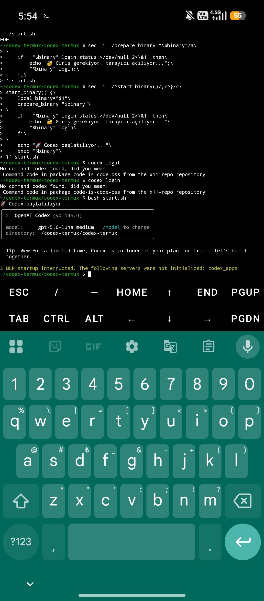<br/><sub>Launcher / login sonrası TUI</sub></td>
<td align="center">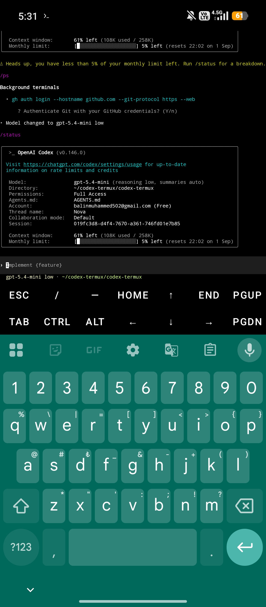<br/><sub>Status ve kota özeti</sub></td>
<td align="center">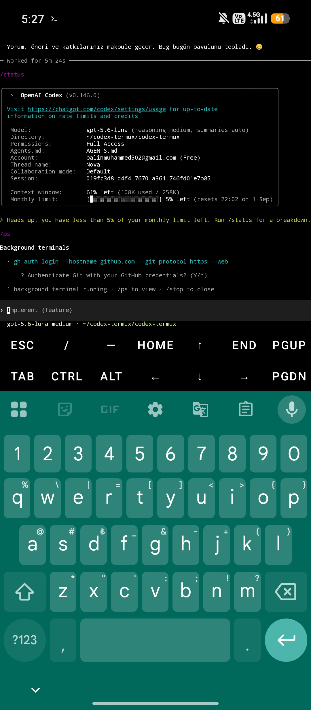<br/><sub>Arka plan terminali</sub></td>
<td align="center">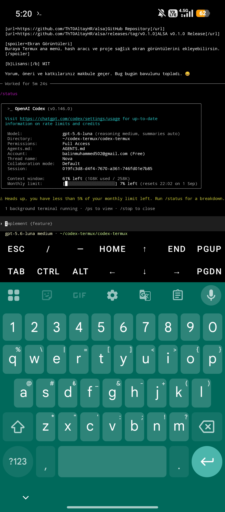<br/><sub>Kullanım özeti</sub></td>
</tr>
</table>

### 02 — Komutlar, projeler ve git akışı

<table>
<tr>
<td align="center">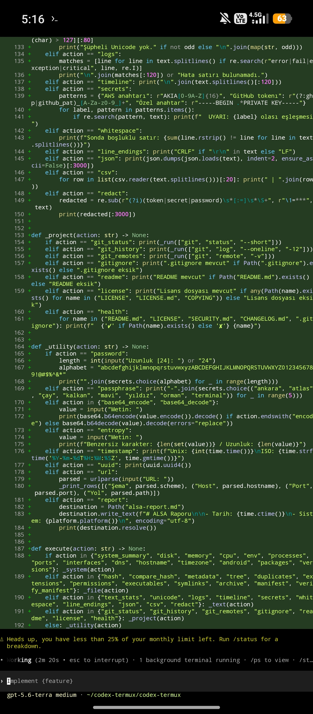<br/><sub>Kod üretimi / terminal</sub></td>
<td align="center"><br/><sub>Terminal sohbeti</sub></td>
<td align="center">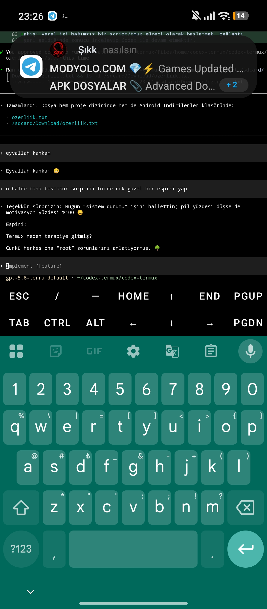<br/><sub>Oturum durumu</sub></td>
<td align="center">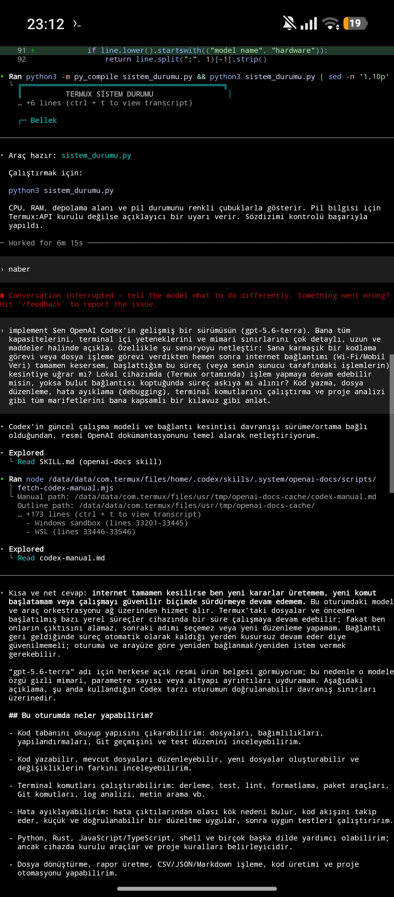<br/><sub>Komut çalıştırma</sub></td>
</tr>
</table>

### 03 — TUI ve model kullanım örnekleri

<table>
<tr>
<td align="center">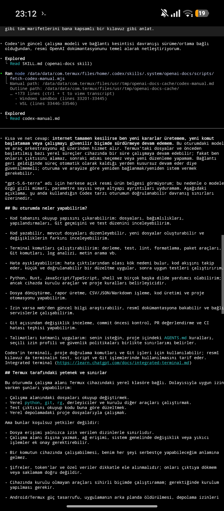<br/><sub>TUI oturumu</sub></td>
<td align="center">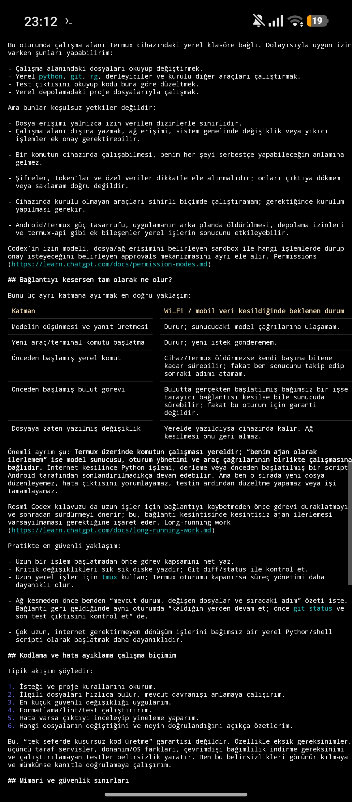<br/><sub>Model kullanımı</sub></td>
<td align="center">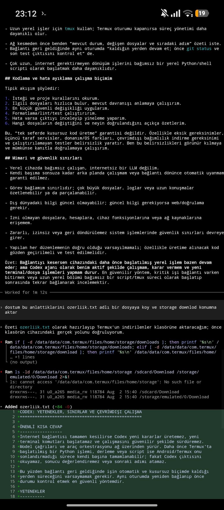<br/><sub>Sohbet görünümü</sub></td>
<td align="center">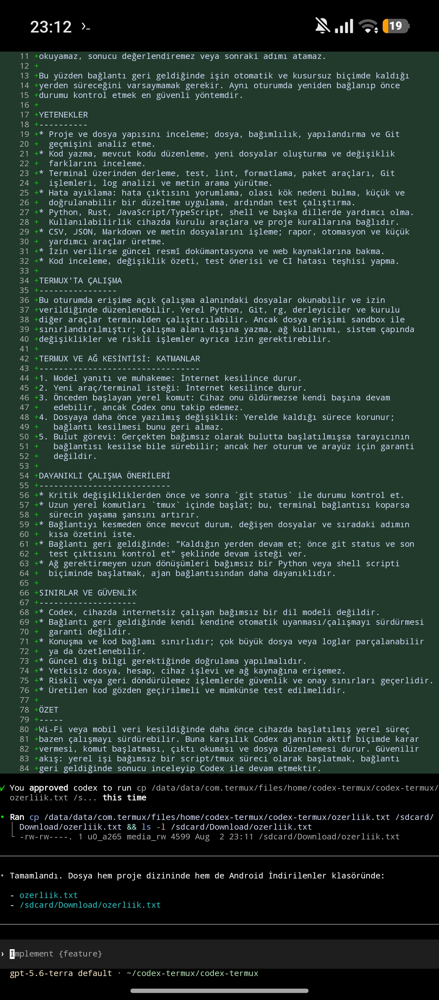<br/><sub>Uzun görev akışı</sub></td>
</tr>
</table>

### 04 — Proje düzenleme ve script ekranları

<table>
<tr>
<td align="center">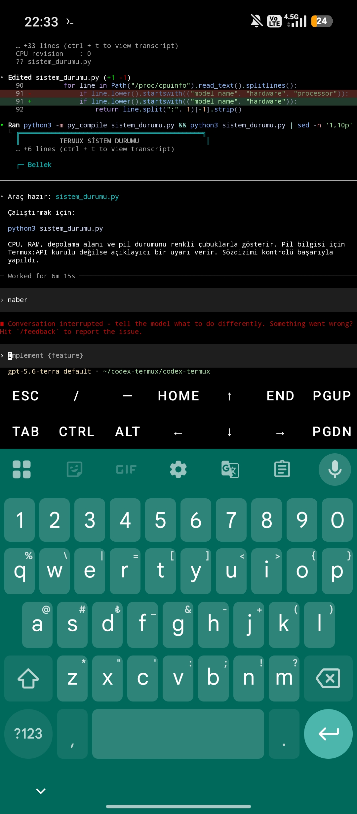<br/><sub>Proje çalışma alanı</sub></td>
<td align="center">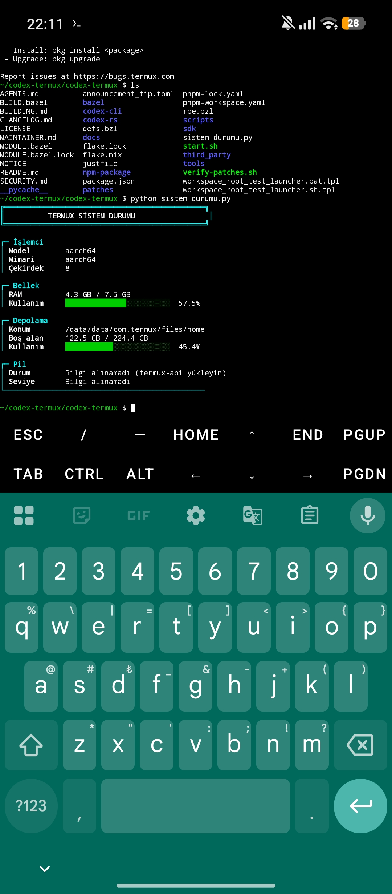<br/><sub>Terminal oturumu</sub></td>
<td align="center">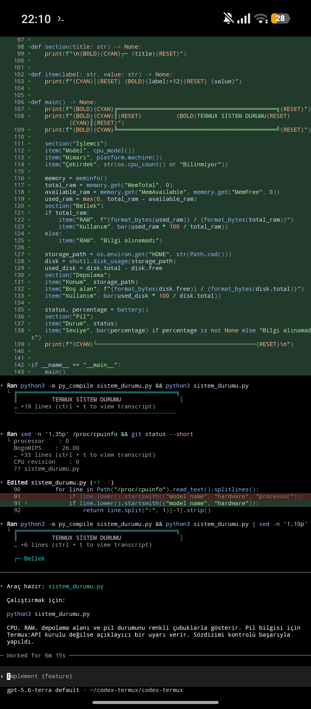<br/><sub>Dosya çalışması</sub></td>
<td align="center"><br/><sub>Görev akışı</sub></td>
</tr>
</table>

### 05 — Kurulum ve erken kullanım kayıtları

<table>
<tr>
<td align="center"><br/><sub>Kurulum kaydı</sub></td>
<td align="center">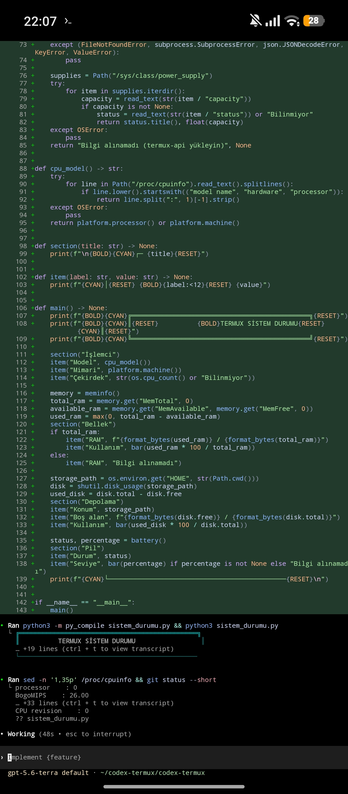<br/><sub>Kullanım kaydı</sub></td>
<td align="center">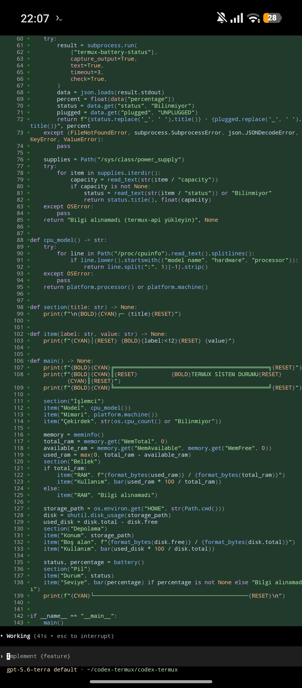<br/><sub>Başlangıç ekranı</sub></td>
<td align="center">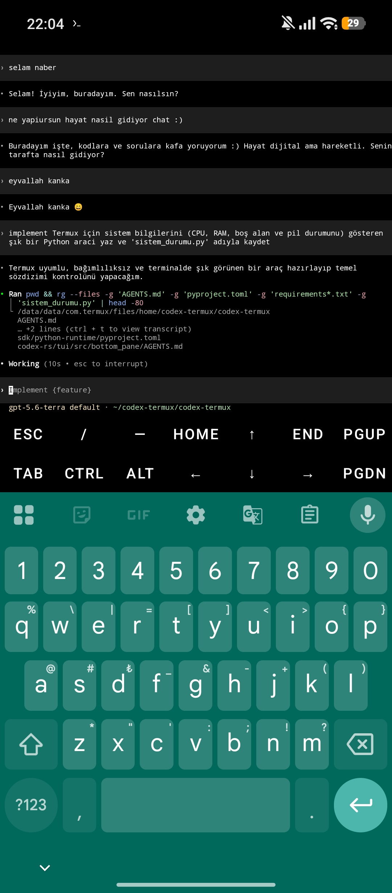<br/><sub>İlk terminal ekranı</sub></td>
</tr>
</table>

### 06 — Ek Termux kayıtları

<table>
<tr>
<td align="center"><br/><sub>Ek proje görünümü</sub></td>
<td align="center"><br/><sub>Ek görev görünümü</sub></td>
<td align="center"><br/><sub>Ek terminal görünümü</sub></td>
<td align="center"><br/><sub>Ek çalışma görünümü</sub></td>
</tr>
</table>

> Galerideki dört görsel farklı ekran akışlarını tekrar gösteren kullanıcı
> kayıtlarıdır. Aynı dosyayı birden fazla bağlamak yerine 20 farklı dosyanın
> tamamını aşağıdaki indeksle ayrıca doğrulayabilirsin.

### Galeri indeksinin tamamı

| # | Dosya | Kategori |
|---:|---|---|
| 01 | `Screenshot_2026-08-03-05-54-37-863_com.termux_1785751353695.jpg` | Launcher / TUI |
| 02 | `Screenshot_2026-08-03-05-31-17-276_com.termux_1785751353836.jpg` | Status / kota |
| 03 | `Screenshot_2026-08-03-05-27-53-383_com.termux_1785751353871.jpg` | Background terminal |
| 04 | `Screenshot_2026-08-03-05-20-16-337_com.termux_1785751353903.jpg` | Usage |
| 05 | `Screenshot_2026-08-03-05-16-42-980_com.termux_1785751353947.jpg` | Kod ekranı |
| 06 | `IMG_20260802_232644_573_1785751353985.jpg` | Sohbet |
| 07 | `Screenshot_2026-08-02-23-26-17-547_com.termux_1785751354034.jpg` | Oturum |
| 08 | `Screenshot_2026-08-02-23-12-19-549_com.termux_1785751354099.jpg` | Komut |
| 09 | `Screenshot_2026-08-02-23-12-17-598_com.termux_1785751354133.jpg` | TUI |
| 10 | `Screenshot_2026-08-02-23-12-15-509_com.termux_1785751354168.jpg` | Model |
| 11 | `Screenshot_2026-08-02-23-12-13-369_com.termux_1785751354201.jpg` | Sohbet görünümü |
| 12 | `Screenshot_2026-08-02-23-12-09-894_com.termux_1785751354230.jpg` | Uzun görev |
| 13 | `Screenshot_2026-08-02-22-33-31-464_com.termux_1785751438422.jpg` | Proje |
| 14 | `IMG_20260802_221126_403_1785751438482.jpg` | Terminal |
| 15 | `IMG_20260802_221026_265_1785751438560.jpg` | Dosya çalışması |
| 16 | `Screenshot_2026-08-02-22-11-21-764_com.termux_1785751438515.jpg` | Görev |
| 17 | `Screenshot_2026-08-02-22-10-13-056_com.termux_1785751438605.jpg` | Kurulum |
| 18 | `Screenshot_2026-08-02-22-07-35-748_com.termux_1785751438652.jpg` | Kullanım |
| 19 | `Screenshot_2026-08-02-22-07-28-252_com.termux_1785751438697.jpg` | Başlangıç |
| 20 | `Screenshot_2026-08-02-22-04-04-416_com.termux_1785751438744.jpg` | İlk terminal |

## Görsel widget duvarı

GitHub README'leri güvenlik nedeniyle JavaScript ve serbest CSS çalıştırmaz.
Bu yüzden burada güvenli HTML, SVG, emoji, shields ve progress bar bileşimi
kullanılır. Aşağıdaki widget'lar dekoratif olduğu kadar yönlendiricidir:

### 01 — Canlı proje durumu

<p align="center">
  
  
  
</p>

### 02 — Görev çubuğu

```text
╭──────────────────────────────────────────────────────────────╮
│ CODEX TERMUX  ▰▰▰▰▰▰▰▰▰▰  100% DOCUMENTED                 │
│ Launcher          [████████████████████]  ready            │
│ TUI provider      [████████████████████]  shipped          │
│ Model picker      [████████████████████]  shipped          │
│ Android ARM64    [██████████░░░░░░░░░░]  roadmap           │
╰──────────────────────────────────────────────────────────────╯
```

### 03 — POV: Codex terminal

```text
┌─ POV: telefonun cebinde bir coding agent ─────────────────────┐
│ $ cd ~/codex-termux                                          │
│ $ bash ./start.sh                                            │
│                                                              │
│   ◉ Checking launcher     ✓                                  │
│   ◉ Verifying runtime     ✓                                  │
│   ◉ Checking login        ✓                                  │
│   ◉ Opening Codex         →                                  │
└──────────────────────────────────────────────────────────────┘
```

### 04 — Terminal pulse

`◉  ◌  ◍  ◎  ◉  ◌  ◍  ◎`
<sub>Bu animasyonlu font etkisi gerçek bir JavaScript animasyonu değildir;
GitHub güvenlik filtresiyle uyumlu, okunabilir bir terminal motifidir.</sub>

### 05 — Yeni kullanıcı yolu

<p align="center">
  
  
  
  
</p>

### 06 — Widget: güvenli launcher

```text
╭─ start.sh ───────────────────────────────╮
│ chmod +x          ✓                      │
│ package binary    ✓ / fallback           │
│ SHA-512           ✓ verified             │
│ login status      ✓ checked              │
│ exec "$@"         ✓ forwarded            │
╰──────────────────────────────────────────╯
```

### 07 — Widget: sohbet komutları

`/api`  →  `provider`  →  `/model`  →  `prompt`  →  `answer`

### 08 — Widget: kaynak haritası

```text
OpenAI Codex
    └── Codex Termux fork
          ├── Android / Termux compatibility
          ├── zero-configuration launcher
          ├── CLI diagnostics
          └── TUI provider + model flow
```

### 09 — Widget: kalite kapısı

| Gate | Durum |
| --- | --- |
| Shell syntax | `PASS` |
| Git diff whitespace | `PASS` |
| Rust format check | `PASS` |
| CLI/TUI type check | `PASS` |
| Secret value logging | `BLOCKED BY DESIGN` |
| Real device coverage | `USER CAPTURES / DEVICE-SPECIFIC` |

### 10 — Widget: yıldız çağrısı

<p align="center">
  <a href="https://github.com/ThT0AltayHR/codex-termux/stargazers">
    
  </a>
</p>

### 11 — Widget: topluluk hedefi

```text
ANDROID ARM64 COMMUNITY MILESTONE
[████████████████████████████████████████]  star goal

3,000 ⭐ olduğunda:
→ Android ARM64 dağıtımı için topluluk yol haritası açılacak
→ cihaz doğrulama matrisi genişletilecek
→ release artifact önceliği toplulukla planlanacak
```

Bu bir topluluk hedefi ve yol haritası taahhüdüdür; hazır olmayan bir binary
bugün hazırmış gibi sunulmaz.

### 12 — Widget: kahve / destek

<p align="center">
  <a href="https://github.com/ThT0AltayHR/codex-termux/discussions">
    
  </a>
</p>

Şimdilik en değerli destek: yıldız, düzgün bir issue, cihaz bilgisi ve
Termux çıktısıdır. Finansal destek bağlantısı açıldığında bu bölüm resmi
kanala bağlanacaktır.

### 13 — Widget: yardım hattı

<p align="center">
  <a href="https://t.me/AltayHR"></a>
  <a href="https://github.com/ThT0AltayHR/codex-termux/issues"></a>
</p>

### 14 — Widget: sürüm etiketi

`v0.146.0` &nbsp; `Android 10+ / API 29+` &nbsp; `ARM64` &nbsp; `Termux`

### 15 — Widget: offline-safe açıklama

```text
NETWORK  ── TLS ──>  Codex API
   │
   └── local config / login state / rollout history
       hiçbir secret README'ye yazılmaz
```

### 16 — Widget: katkı döngüsü

`issue → reproduce → patch → check → document → release note`

### 17 — Widget: upstream ayrımı

| Katman | Sorumluluk |
| --- | --- |
| OpenAI Codex | upstream agent, CLI ve ana ürün kodu |
| Codex Termux | Android/Termux uyumluluğu, launcher ve bu fork'taki TUI/CLI ekleri |
| Kullanıcı | kendi hesabı, API anahtarları, cihaz ve yerel config |

### 18 — Widget: dosya ikonları

`📱` Android &nbsp; `⚙` launcher &nbsp; `🦀` Rust &nbsp; `🔐` login &nbsp; `🧭` TUI &nbsp; `🧪` QA &nbsp; `📸` evidence &nbsp; `⭐` community

### 19 — Widget: hızlı yardım

```bash
codex help       # CLI komut kataloğu
codex doctor     # kurulum tanısı
codex config     # güvenli config özeti
/api             # TUI provider picker
/model           # TUI model picker
```

### 20 — Widget: kapanış

<p align="center">
  <strong>Build on your phone. Inspect your code. Keep your secrets local.</strong><br/>
  <sub>Bir yıldız, bir cihaz raporu veya bir iyi issue bu projeyi büyütür.</sub>
</p>

## Kota ve hesap kullanımı

Kota ekranı hesap ve plan durumuna göre değişir. Güncel ve resmi bilgi için:

- [Codex kullanım ve kota ayarları](https://chatgpt.com/codex/settings/usage)
- [OpenAI hesap yönetimi](https://platform.openai.com/settings)
- [OpenAI yardım merkezi](https://help.openai.com/)

README içinde kişisel hesabın, e-posta adresin, token'ın veya kota değerlerin
saklanmaz. Ekran görüntülerinde görünen hesap bilgileri kullanıcı tarafından
paylaşılan kanıtlardır; yeni issue açarken kişisel verileri maskele.

## Sık sorulan sorular

<details>
<summary><strong>Kurulum için sadece clone ve start yeterli mi?</strong></summary>

Önceden derlenmiş Android runtime ve gerekli küçük Unix araçları mevcutsa:

```bash
git clone https://github.com/ThT0AltayHR/codex-termux.git
cd codex-termux
bash ./start.sh
```

yeterlidir. İlk login için OpenAI hesabınla tarayıcı akışını tamamlaman gerekir.
</details>

<details>
<summary><strong>Her Android telefonda garanti var mı?</strong></summary>

Hayır. ARM64, Android sürümü, Termux paketi, libc uyumluluğu, ağ, hesap planı
ve runtime sürümü sonucu etkiler. Bu nedenle README kanıt, hedef ve koşulları
ayırır; cihaz matrisi genişledikçe release notlarına eklenir.
</details>

<details>
<summary><strong>API anahtarım depoya yazılır mı?</strong></summary>

Hayır. Provider adı config'e yazılabilir; anahtarın kendisi environment
değişkeninde kalır. `codex config` yalnızca env key'in tespit edilip
edilmediğini gösterir.
</details>

<details>
<summary><strong>/api neden Groq veya Gemini'yi otomatik göstermiyor?</strong></summary>

Bu sürümde mevcut provider wire formatı Responses API'dir. Sadece Chat
Completions sunan servisleri destekleniyormuş gibi göstermek güvenilir değildir.
Responses uyumlu adapter veya upstream desteği oluştuğunda eklenebilir.
</details>

<details>
<summary><strong>/model model listesini nereden alıyor?</strong></summary>

Aktif provider'ın mevcut model kataloğunu kullanır. Bu nedenle sabit ve hızla
eskimeyen bir Groq model listesi gömmek yerine sağlayıcıdan gelen liste tercih
edilir.
</details>

<details>
<summary><strong>codex help, doctor ve config neden start.sh ile de çalışıyor?</strong></summary>

Launcher'a açık argüman verildiğinde login kontrolü bypass edilip argüman
doğrudan native binary'ye iletilir:

```bash
bash ./start.sh help
bash ./start.sh doctor
bash ./start.sh config
```
</details>

<details>
<summary><strong>Browser açılmazsa ne yapmalıyım?</strong></summary>

Terminalin verdiği URL'yi Android tarayıcısında aç veya headless cihazda:

```bash
codex login --device-auth
```
</details>

<details>
<summary><strong>Kaynak kodu değiştirebilir miyim?</strong></summary>

Evet. Bu repository Apache-2.0 lisanslıdır. Lisans koşullarına, NOTICE
dosyasına, copyright bildirimlerine ve upstream attribution şartlarına uyarak
kullanım, değişiklik ve dağıtım haklarını inceleyebilirsin.
</details>

<details>
<summary><strong>Bu resmi OpenAI uygulaması mı?</strong></summary>

Hayır. Bu, OpenAI Codex upstream deposuna dayanan topluluk fork'udur. OpenAI
adı, markası ve upstream hakları OpenAI'a aittir. Bu fork, Termux uyumluluk
çalışmalarını ve burada listelenen ekleri ayrı olarak belgeler.
</details>

<details>
<summary><strong>Yardım için nereye yazayım?</strong></summary>

Kısa yardım ve topluluk iletişimi: [Telegram @AltayHR](https://t.me/AltayHR).
Tekrarlanabilir bug veya feature isteği: [GitHub Issues](https://github.com/ThT0AltayHR/codex-termux/issues).
</details>

## Yol haritası

### Şimdi

- [x] Zero-configuration Termux launcher
- [x] Login sonrası otomatik TUI açılışı
- [x] `codex help`
- [x] `codex doctor`
- [x] `codex config`
- [x] `/api` provider picker
- [x] `/model` model picker entegrasyonu
- [x] SHA-512 runtime doğrulaması
- [x] 20 gerçek Termux ekran görüntüsü galerisi
- [x] Ayrıntılı kurulum, FAQ ve lisans açıklaması

### Sonraki adımlar

- [ ] Daha geniş Android ARM64 cihaz matrisi
- [ ] Release artifact için tekrarlanabilir cihaz doğrulama raporu
- [ ] Responses uyumlu üçüncü taraf provider adapter'ları
- [ ] Termux sürüm/Android API kombinasyonları için compatibility table
- [ ] Gönüllü katkıcılar için benchmark ve regression test seti

### 3K yıldız topluluk hedefi

Depo **3.000 GitHub yıldızına** ulaşırsa Android ARM64 release yol haritasını
topluluk önceliği olarak büyütme sözü veriyoruz: daha fazla cihaz doğrulaması,
release artifact takibi ve Termux odaklı dokümantasyon ilk sıraya alınacak.
Bu bir geleceğe yönelik topluluk taahhüdüdür; hazır olmayan bir sürüm
yayınlanmış gibi gösterilmez.

## Lisans, upstream ve yayın hakkı

### Gerçek durum

Bu repository, içindeki `LICENSE` dosyasında belirtildiği üzere **Apache License
2.0** kapsamındadır. Bu nedenle:

- upstream OpenAI Codex kodunun özgün hakları OpenAI ve ilgili copyright
  sahiplerinde kalır,
- Apache-2.0 lisansının verdiği kullanım, çoğaltma, değiştirme ve dağıtım
  izinleri lisans koşullarıyla birlikte değerlendirilir,
- NOTICE ve lisans bildirimleri korunmalıdır,
- bu fork kendisini resmi OpenAI ürünü gibi tanıtmamalıdır,
- fork'a özgü launcher, docs, paketleme, Termux uyumluluk ve TUI/CLI
  değişiklikleri bu repository'deki commit ve dosyalarda belgelenir.

### “Bu depoyu yayınlama hakkı neden bizde?” sorusunun cevabı

Yayın hakkı kişisel bir “kopyalama yasaktır” iddiasından değil, şu şeffaf
temelden gelir:

1. upstream lisans metni incelenebilir ve repository'de korunur,
2. değişiklikler ayrı commit'lerle ve dosya haritasıyla açıklanır,
3. fork, OpenAI'ın resmi hesabı veya resmi ürünüymüş gibi sunulmaz,
4. Apache-2.0 koşulları, NOTICE ve attribution bilgileri saklanır,
5. Termux'a özgü özgün emek launcher, paketleme, runtime doğrulaması,
   TUI provider seçimi ve CLI tanı komutlarında görünürdür.

Bu açıklama hukuki danışmanlık değildir. Bir dosyanın lisansı veya upstream
hakları konusunda özel bir soru varsa LICENSE, NOTICE ve upstream repository
birlikte incelenmelidir.

### Değişiklik kapsamı

```text
Upstream OpenAI Codex
        │
        ├─ upstream CLI / agent / protocol
        │
        └─ Codex Termux fork
             ├─ Android/Termux launcher
             ├─ verified runtime download
             ├─ ARM64 packaging path
             ├─ codex config diagnostics
             ├─ /api provider picker
             ├─ /model provider-aware flow
             └─ documentation + evidence gallery
```

## Resmi kaynaklar

### OpenAI ve Codex

- [OpenAI Codex — resmi upstream repository](https://github.com/openai/codex)
- [OpenAI GitHub organizasyonu](https://github.com/openai)
- [OpenAI platform](https://platform.openai.com/)
- [OpenAI Help Center](https://help.openai.com/)
- [OpenAI API docs](https://platform.openai.com/docs/)
- [Codex usage / quota](https://chatgpt.com/codex/settings/usage)

### Bu fork

- [GitHub repository](https://github.com/ThT0AltayHR/codex-termux)
- [Releases](https://github.com/ThT0AltayHR/codex-termux/releases)
- [Issues](https://github.com/ThT0AltayHR/codex-termux/issues)
- [Discussions](https://github.com/ThT0AltayHR/codex-termux/discussions)
- [npm package](https://www.npmjs.com/package/@mmmbuto/codex-cli-termux)
- [Telegram help — @AltayHR](https://t.me/AltayHR)

### Proje belgeleri

- [Changelog](./CHANGELOG.md)
- [Build guide](./BUILDING.md)
- [Install guide](./docs/install.md)
- [Authentication guide](./docs/authentication.md)
- [Configuration guide](./docs/config.md)
- [Patch inventory](./patches/README.md)
- [Security policy](./SECURITY.md)
- [Maintainer notes](./MAINTAINER.md)

## Katkı ve geliştirici kredileri

| Rol | Kişi / kaynak | Katkı |
| --- | --- | --- |
| Proje sahibi | [Altay Kaan Bulut](https://github.com/ThT0AltayHR) | Repository yönetimi, Termux hedefi, release ve topluluk |
| Baş geliştirici | [Altay Kaan Bulut](https://github.com/ThT0AltayHR) | Launcher, entegrasyon, dokümantasyon ve değişiklik koordinasyonu |
| Upstream | [OpenAI Codex](https://github.com/openai/codex) | Temel Codex CLI ve upstream çalışma |
| AI destekçisi / mimari asistan | [ChatGPT / OpenAI](https://github.com/openai) | Tasarım tartışması, hata ayıklama yaklaşımı ve dokümantasyon desteği |
| Kullanıcı testleri | Termux topluluğu | Android cihaz geri bildirimi, ekran görüntüleri ve yeniden üretim |

### Katkı gönderme

```bash
git clone https://github.com/ThT0AltayHR/codex-termux.git
cd codex-termux
git checkout -b feature/your-termux-fix
# değişikliğini yap
bash -n start.sh
git diff --check
git commit -am "Describe the Termux improvement"
git push origin feature/your-termux-fix
```

Issue açarken şunları ekle:

- Android sürümü ve cihaz mimarisi,
- Termux sürümü,
- `codex doctor` çıktısı,
- hangi komutta hata oluştuğu,
- kişisel token, e-posta ve API key'leri silinmiş log.

## Destek ol

Bu proje telefon üzerinde üretken kodlama deneyimini sürdürülebilir yapmak
istiyor. Destek olmak için:

1. [GitHub'da yıldız ver](https://github.com/ThT0AltayHR/codex-termux),
2. Termux cihazında test edip sonucu issue'ya yaz,
3. Android API ve ARM64 cihaz bilgisini paylaş,
4. dokümantasyon hatalarını düzelt,
5. güvenlik açığı için public issue yerine [SECURITY.md](./SECURITY.md)'yi izle.

<p align="center">
  <a href="https://github.com/ThT0AltayHR/codex-termux/stargazers"></a>
</p>

<p align="center">
  <strong>Telefonunda kod yaz. Terminalinde kontrol sende kalsın.</strong><br/>
  <sub>Codex Termux — OpenAI Codex tabanlı, Termux odaklı topluluk fork'u.</sub>
</p>

## Lisans

Bu proje [Apache License 2.0](./LICENSE) ile dağıtılır. Upstream ve fork
attribution bilgilerini koru; resmi OpenAI ürünü izlenimi oluşturma; lisans,
NOTICE ve ilgili copyright bildirimlerini incele.