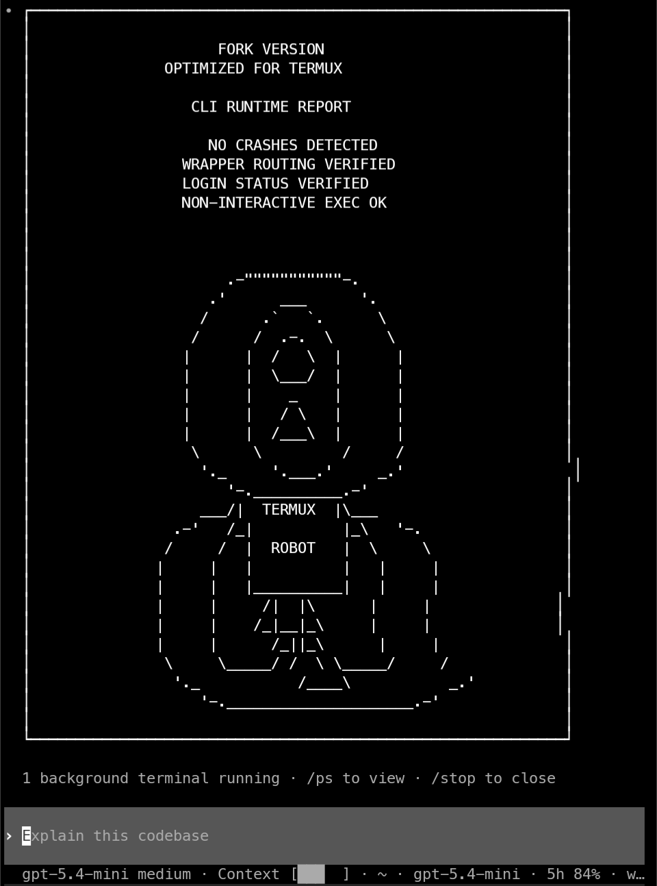
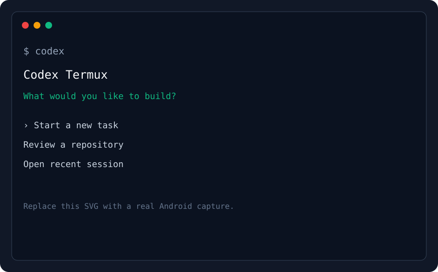
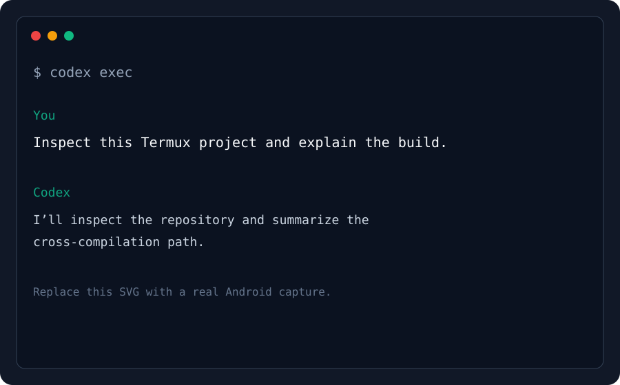
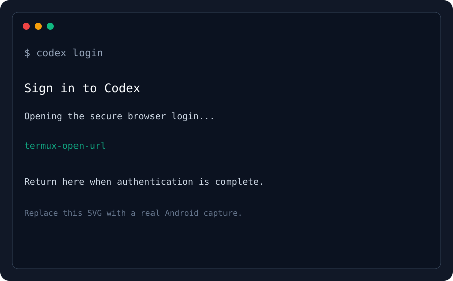

<p align="center">
  <svg width="112" height="112" viewBox="0 0 112 112" role="img" aria-label="OpenAI Codex Termux">
    <title>OpenAI Codex Termux</title>
    <circle cx="56" cy="56" r="48" fill="none" stroke="#10a37f" stroke-width="4">
      <animate attributeName="opacity" values="0.45;1;0.45" dur="4s" repeatCount="indefinite" />
    </circle>
    <path d="M56 22c-7 0-13 4-16 10-7-1-14 2-17 8-4 6-3 13 1 19-4 6-3 14 1 19 4 6 11 8 18 7 4 6 10 10 17 10s13-4 17-10c7 1 14-2 18-7 4-6 5-13 1-19 4-6 5-13 1-19-4-6-10-9-17-8-3-6-9-10-17-10Z" fill="none" stroke="#10a37f" stroke-width="4" stroke-linejoin="round" />
    <path d="M38 43c6 3 10 8 10 15s-4 12-10 15m36-30c-6 3-10 8-10 15s4 12 10 15M43 56h26" fill="none" stroke="#10a37f" stroke-width="4" stroke-linecap="round" />
  </svg>
</p>

<h1 align="center">Codex Termux</h1>

<p align="center">
  Native Codex CLI for Android ARM64 — bringing a focused, terminal-first coding agent to Termux.
</p>

<p align="center">
  <a href="https://github.com/ThT0AltayHR/codex-termux"></a>
  <a href="https://github.com/ThT0AltayHR/codex-termux/actions/workflows/termux-npm-build-publish.yml"></a>
  <a href="https://github.com/ThT0AltayHR/codex-termux/blob/main/LICENSE"></a>
</p>

<p align="center">
  <a href="https://www.npmjs.com/package/@mmmbuto/codex-cli-termux">npm package</a>
  ·
  <a href="https://github.com/ThT0AltayHR/codex-termux/releases/latest">latest release</a>
  ·
  <a href="https://github.com/ThT0AltayHR/codex-termux/issues">report an issue</a>
</p>

<p align="center">
  
</p>

## Install in one command

### Termux (Android ARM64)

```bash
git clone https://github.com/ThT0AltayHR/codex-termux.git
cd codex-termux
./start.sh
```

`start.sh` makes its launcher executable, checks for Node.js and Rust, prefers
the bundled Android binary, and falls back to the local Rust source build when
the platform package is unavailable. After the launcher opens, complete the
normal `codex login` flow.

For the published package instead:

```bash
pkg update && pkg upgrade -y
pkg install nodejs-lts -y
npm install -g @mmmbuto/codex-cli-termux@latest
codex login
```

Requirements:

- Android 10+ / API 29+ (the release binary is built with the API 29 NDK target)
- ARM64 device
- Node.js >= 18

## Scope

What this fork does:

- tracks upstream OpenAI Codex closely
- builds native Android ARM64 binaries for Termux
- applies only the compatibility patches upstream does not ship
- publishes GitHub release assets and an npm package for Termux users

What this fork does not do:

- maintain a broad feature fork
- replace upstream Codex
- carry fork-only product features unrelated to Termux compatibility

## Current Termux Delta

- browser login uses `termux-open-url`
- self-update points to `ThT0AltayHR/codex-termux` and `@mmmbuto/codex-cli-termux`
- packaged wrappers set `CODEX_SELF_EXE` to the native ELF, sanitize `LD_LIBRARY_PATH`, and bundle `libc++_shared.so`
- Android binaries are linked with `RUNPATH=$ORIGIN`
- `exec`/code-mode now runs for real on Android via the in-process V8 runtime (no longer a stub) — the meaningful capability gain on Termux
- realtime voice/audio is no longer part of this build: upstream removed the TUI realtime voice feature (openai/codex#27801), so the fork's Android cpal/oboe enablement toggle (never usable from the Termux CLI anyway, as the backend needs an Android JavaVM/Activity) was dropped with it. Termux-native audio remains tracked on the Codex VL roadmap.
- Android PTY and lock-handling compatibility patches remain enabled where upstream behavior still breaks on Bionic/Termux

## Terminals / Screenshots

The checked-in SVGs below are clearly labeled placeholders, not claims of
device validation. Replace them with real Android ARM64 captures in
`docs/screenshots/` when available:

<p align="center">
  
  
  
</p>

<p align="center">
  <sub>Menu · Query · Login — replace the labeled placeholders with real Android ARM64 captures.</sub>
</p>

## Official resources

- [OpenAI Codex repository](https://github.com/openai/codex)
- [OpenAI GitHub organization](https://github.com/openai)
- [Codex Termux releases](https://github.com/ThT0AltayHR/codex-termux/releases)

## Contributors

| Role | Contributor |
| --- | --- |
| Project owner and lead developer | [Altay Kaan Bulut](https://github.com/ThT0AltayHR) |
| AI supporter and architecture assistant | [ChatGPT / OpenAI](https://github.com/openai) |

## Support the project

If Codex Termux helps you write, explore, or ship from your phone, please
[give the repository a star](https://github.com/ThT0AltayHR/codex-termux). A star
is a small signal that helps other Termux users discover the project and keeps
the maintenance effort visible.

## Releases and Updates

- Latest GitHub release: [releases/latest](https://github.com/ThT0AltayHR/codex-termux/releases/latest)
- Upstream base: OpenAI Codex `rust-v0.146.0`. The `0.146.0` Android package
  follows the exact-artifact release flow; npm dist-tags and GitHub Releases
  are authoritative for current publication status.
- npm package: [`@mmmbuto/codex-cli-termux`](https://www.npmjs.com/package/@mmmbuto/codex-cli-termux)
- Legacy `@mmmbuto/codex-cli-lts` (OpenAI Codex 0.80.x) is archived; current builds live in this package or in [`@mmmbuto/codex-vl`](https://www.npmjs.com/package/@mmmbuto/codex-vl) (multi-platform).

Maintainer publish flow:

- build the exact sanitized candidate with GitHub Actions and audit its
  immutable npm tarball
- land the validated full tree on `develop`
- publish that unchanged tarball to `next`
- promote the tested sanitized commit to clean GitHub `main`
- point `latest` and `next` at the stable version, then publish the annotated
  tag and GitHub release from `main`
- publish a post-release Termux device-validation summary

## Documentation

- [Changelog](./CHANGELOG.md)
- [Patch inventory](./patches/README.md)
- [Building from source](./BUILDING.md)
- The 0.146.0 on-device validation summary is pending the release artifact and
  post-build device testing.
- [Install docs](./docs/install.md)
- [Authentication](./docs/authentication.md)
- [Configuration](./docs/config.md)

## Security

This is a community fork of OpenAI Codex. Security-relevant properties of this build:

- **Network**: agents bind to loopback by default; nothing is exposed externally unless you opt in.
- **Supply chain**: builds and releases come only from fork-owned CI and the `@mmmbuto/...` npm
  scope. This package does not silently fetch or run the upstream installer; updates flow through
  the fork's own channel.
- **Termux**: TLS trust uses bundled webpki roots (no Android platform-verifier dependency).
  The daemon, history, PATH-alias, installation-id, and policy lock sites that are safe to run
  without advisory exclusion degrade only when the filesystem reports locking as unsupported;
  credential and certificate transactions remain fail-closed.

For sensitive work, prefer the official Codex CLI on Linux/macOS over SSH.

To report a vulnerability, see [SECURITY.md](./SECURITY.md).

## Community guides

- [OpenAI Codex CLI on Android via Termux](https://timharbakon.com/openai-codex-cli-android-termux/)
  — independent third-party walkthrough covering Termux setup, the Bionic-libc incompatibility
  this package solves, and a small Hono test project.

## License

This project remains under the Apache 2.0 license inherited from OpenAI Codex.

- Original work: OpenAI
- Termux port: minimal Android compatibility patches

See [LICENSE](./LICENSE).
